<div align="center">


# 🎓 EdTE-UFTB Alumni App

**A Flutter + Firebase powered alumni & department community app for the Department of Educational Technology & Engineering, UFTB.**


👨‍💻 **Developed by:** Md. Rony Ahmmed Shah &nbsp;|&nbsp; 🆔 **ID:** 2002035

</div>

---

## 📖 Table of Contents

- [✨ Overview](#-overview)
- [🚀 Key Features](#-key-features)
- [🔐 Authentication](#-authentication)
- [✅ Form Validation](#-form-validation)
- [🔥 Firebase Integration](#-firebase-integration)
- [🧭 Bottom Navigation](#-bottom-navigation)
- [👤 Profile](#-profile)
- [👥 People (Students & Teachers)](#-people-students--teachers)
- [🗂️ JSON Data Structure](#️-json-data-structure)
- [📝 Posts](#-posts)
- [⚙️ Settings](#️-settings)
- [📱 Dynamic App Walkthrough](#-dynamic-app-walkthrough)
- [🛠️ Tech Stack](#️-tech-stack)
- [📁 Project Structure](#-project-structure)
- [⚡ Getting Started](#-getting-started)
- [🗺️ Roadmap](#️-roadmap)
- [📬 Contact](#-contact)

---

## ✨ Overview

**EdTE-UFTB Alumni App** is a mobile-first community platform that connects **students, alumni and teachers** of the Educational Technology & Engineering department. Users can create an account, browse alumni by career category, view detailed professional profiles, contact faculty members, and share job posts or updates with the community.

> 💡 The goal: build a strong alumni network where current students can find mentors, jobs and guidance from graduates already working in the industry.

---

## 🚀 Key Features

| Feature | Description |
|---|---|
| 🔐 **Secure Auth** | Sign in / Sign up with Firebase Authentication |
| ✅ **Smart Validation** | Regex email check, 11-digit phone, password rules, confirm-password match |
| 🏠 **Home Dashboard** | Welcome screen with greeting, quick stats and quick access cards |
| 👤 **User Profile** | Personal info, avatar and status badge |
| 🎓 **Alumni Directory** | Searchable and filterable list (Software, Bank, Education, Government) |
| 👨‍🏫 **Faculty Directory** | Teacher list with designation filter, **Send Email** and **Call Now** actions |
| 🔗 **Social Connect** | LinkedIn, GitHub, Facebook, WhatsApp and Email links per alumnus |
| 📝 **Posts (CRUD)** | Create, edit and delete posts with validation and confirmation dialogs |
| 🔔 **Notices** | Department notice board *(placeholder ready)* |
| ⚙️ **Settings** | Notifications, dark mode, support, sign out |

---

## 🔐 Authentication

Clean, modern **Sign In** and **Sign Up** screens built with Material 3.

<div align="center">
  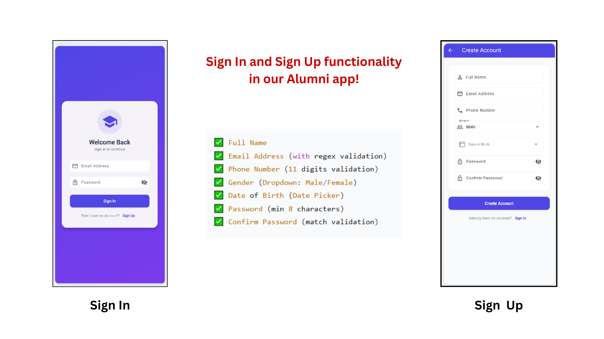
</div>

### Sign Up fields

- ✅ **Full Name**
- ✅ **Email Address** (with regex validation)
- ✅ **Phone Number** (11 digits validation)
- ✅ **Gender** (Dropdown: Male / Female)
- ✅ **Date of Birth** (Date Picker)
- ✅ **Password** (min 8 characters)
- ✅ **Confirm Password** (match validation)

---

## ✅ Form Validation

Every input is validated using Flutter's `validator` callback, so users get instant and clear feedback before any request reaches Firebase.

<div align="center">
  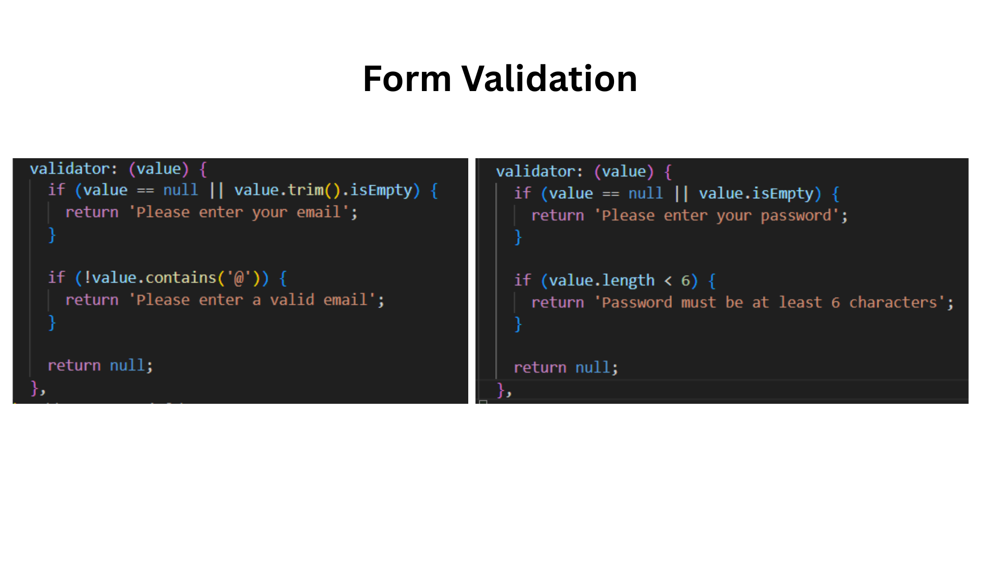
</div>

```dart
validator: (value) {
  if (value == null || value.trim().isEmpty) {
    return 'Please enter your email';
  }
  if (!value.contains('@')) {
    return 'Please enter a valid email';
  }
  return null;
},
```

---

## 🔥 Firebase Integration

The project is connected to Firebase using the **Firebase CLI** and **FlutterFire**.

<div align="center">
  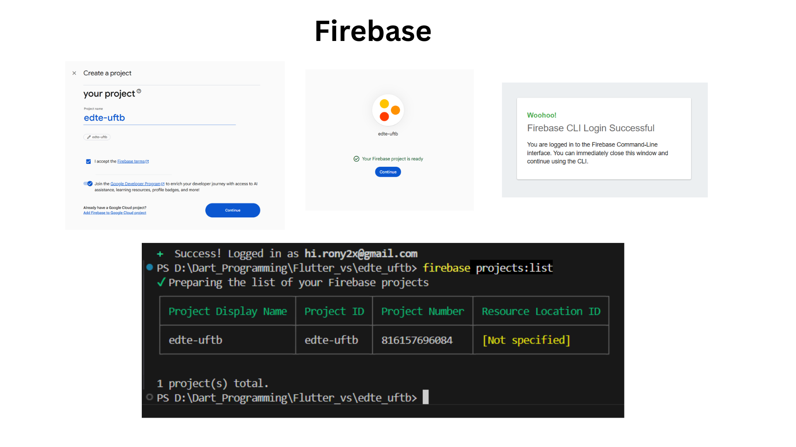
</div>

### Initialization in `main.dart`

<div align="center">
  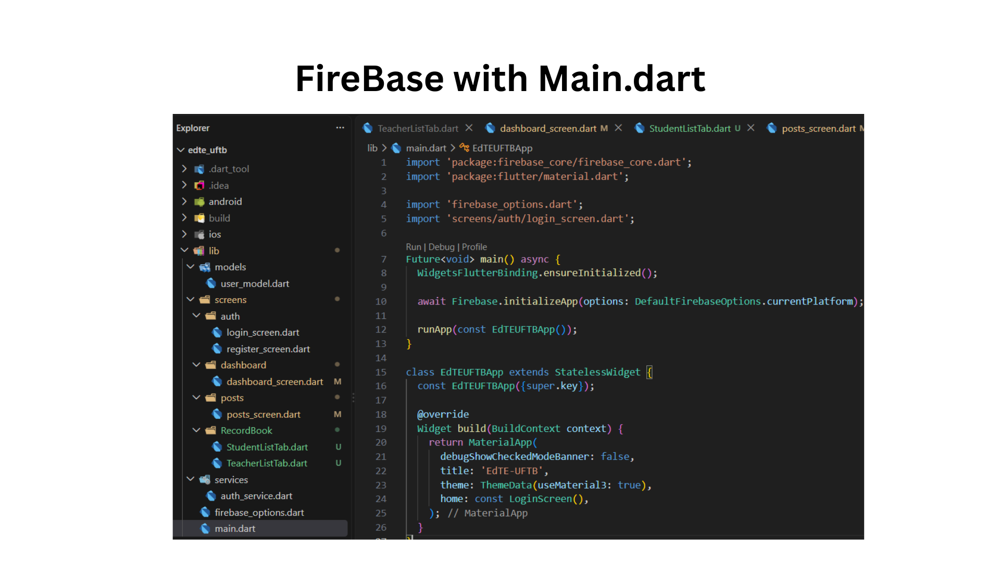
</div>

```dart
Future<void> main() async {
  WidgetsFlutterBinding.ensureInitialized();

  await Firebase.initializeApp(
    options: DefaultFirebaseOptions.currentPlatform,
  );

  runApp(const EdTEUFTBApp());
}
```

---

## 🧭 Bottom Navigation

Five tabs give users quick access to every core area of the app.

<div align="center">
  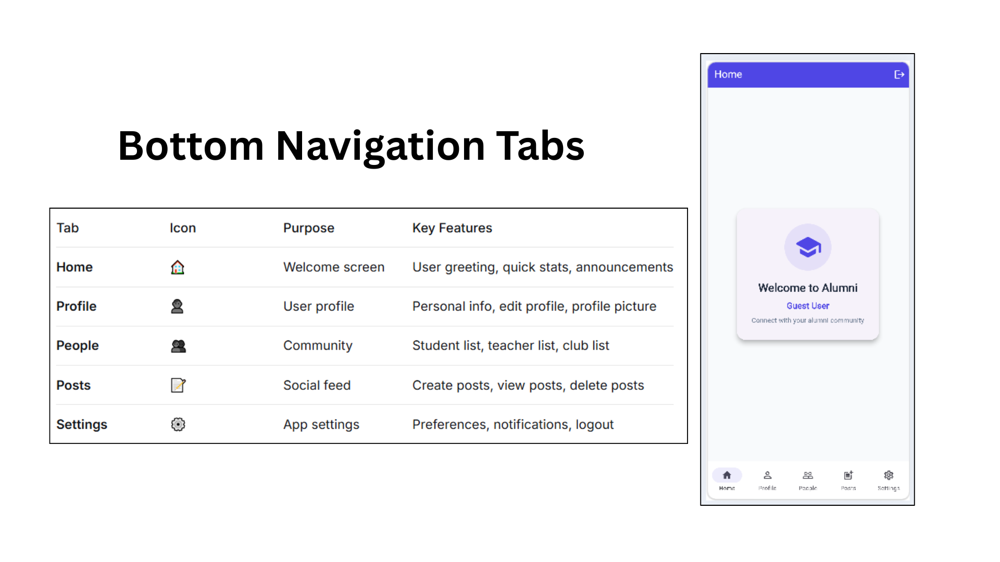
</div>

| Tab | Icon | Purpose | Key Features |
|---|:---:|---|---|
| **Home** | 🏠 | Welcome screen | User greeting, quick stats, announcements |
| **Profile** | 👤 | User profile | Personal info, edit profile, profile picture |
| **People** | 👥 | Community | Student list, teacher list, club list |
| **Posts** | 📝 | Social feed | Create, view and delete posts |
| **Settings** | ⚙️ | App settings | Preferences, notifications, logout |

---

## 👤 Profile

<div align="center">
  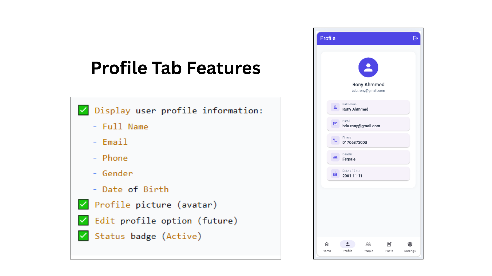
</div>

- ✅ Display user profile information: **Full Name, Email, Phone, Gender, Date of Birth**
- ✅ Profile picture (avatar)
- ✅ Edit profile option *(upcoming)*
- ✅ Status badge (**Active**)

---

## 👥 People (Students & Teachers)

### 🎓 Category selection & Faculty list

<div align="center">
  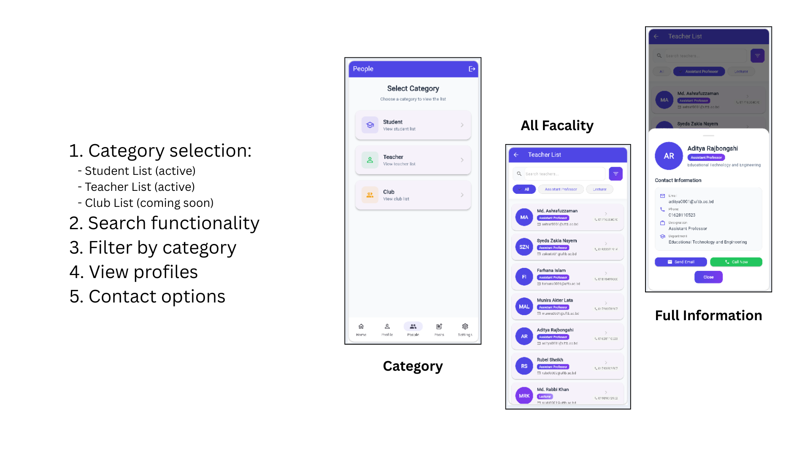
</div>

1. **Category selection**: Student List (active), Teacher List (active), Club List (coming soon)
2. **Search** functionality
3. **Filter** by category / designation
4. **View profiles** in a bottom sheet
5. **Contact options**: Send Email and Call Now

### 🧑‍🎓 Alumni (Student) list

<div align="center">
  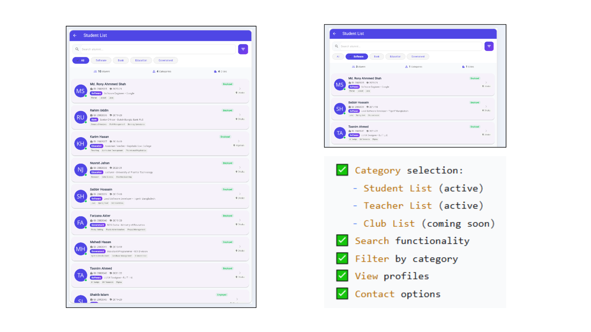
</div>

- Live stats: total **alumni**, **categories** and **cities**
- Category chips: `All` · `Software` · `Bank` · `Education` · `Government`
- Each card shows ID, batch, job title, organization, skills, city and employment status

---

## 🗂️ JSON Data Structure

Alumni data is stored as structured JSON documents, which makes the profile bottom sheet fully dynamic.

<div align="center">
  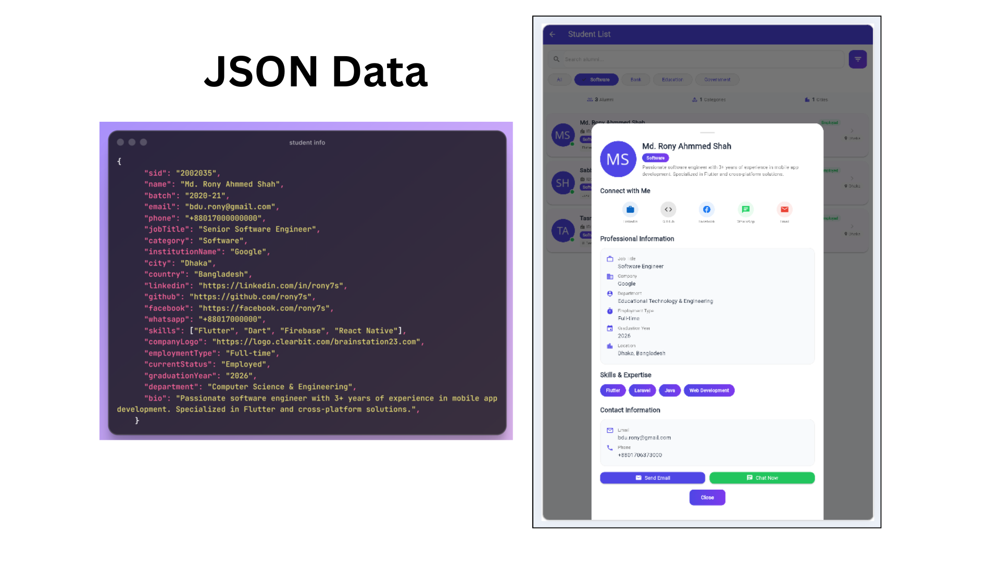
</div>

```json
{
  "sid": "2002035",
  "name": "Md. Rony Ahmmed Shah",
  "batch": "2020-21",
  "email": "bdu.rony@gmail.com",
  "phone": "+88017000000000",
  "jobTitle": "Senior Software Engineer",
  "category": "Software",
  "institutionName": "Google",
  "city": "Dhaka",
  "country": "Bangladesh",
  "linkedin": "https://linkedin.com/in/rony7s",
  "github": "https://github.com/rony7s",
  "facebook": "https://facebook.com/rony7s",
  "whatsapp": "+88017000000",
  "skills": ["Flutter", "Dart", "Firebase", "React Native"],
  "employmentType": "Full-time",
  "currentStatus": "Employed",
  "graduationYear": "2026",
  "department": "Computer Science & Engineering",
  "bio": "Passionate software engineer with 3+ years of experience in mobile app development."
}
```

---

## 📝 Posts

Full **CRUD** flow with validation and a delete confirmation dialog.

<div align="center">
  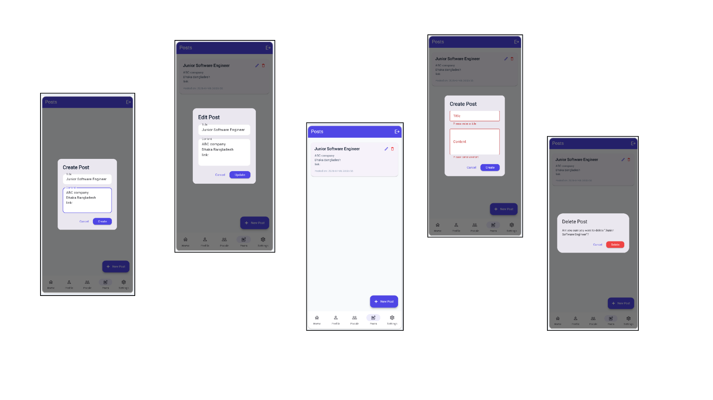
</div>

| Action | Description |
|---|---|
| ➕ **Create** | New post dialog with title and content |
| ✏️ **Edit** | Update an existing post |
| 🗑️ **Delete** | Confirmation dialog before deleting |
| ⚠️ **Validation** | Empty title / content shows an error message |

---

## ⚙️ Settings

<div align="center">
  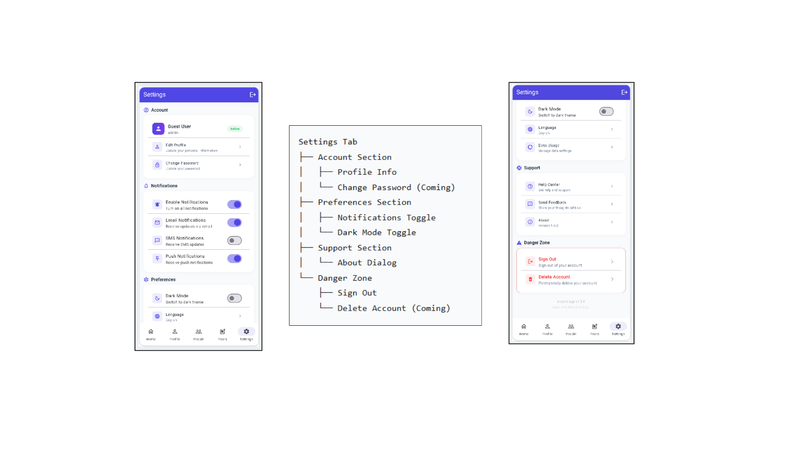
</div>

```text
Settings Tab
├── Account Section
│   ├── Profile Info
│   └── Change Password (Coming)
├── Preferences Section
│   ├── Notifications Toggle
│   └── Dark Mode Toggle
├── Support Section
│   └── About Dialog
└── Danger Zone
    ├── Sign Out
    └── Delete Account (Coming)
```

---

## 📱 Dynamic App Walkthrough

The dynamic version is connected to Firebase and runs on Android, iOS and Web.

### 1️⃣ – 4️⃣ &nbsp; Create Account → Login → Home → Posts

<div align="center">
  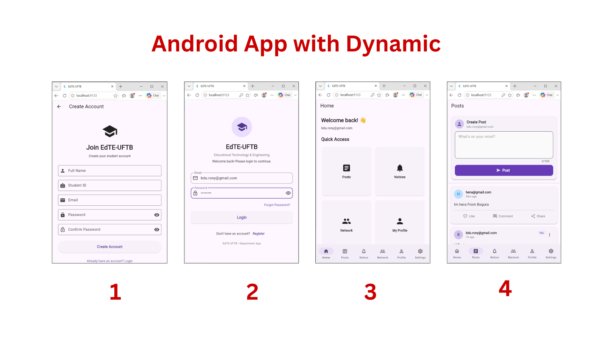
</div>

### 5️⃣ – 7️⃣ &nbsp; Notice → Network (Students) → Alumni Detail

<div align="center">
  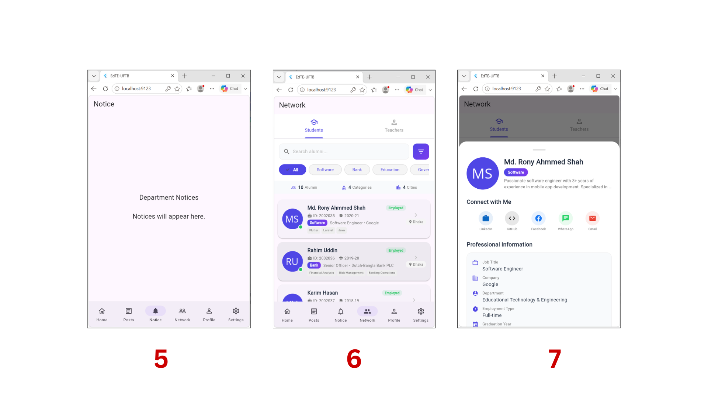
</div>

### 8️⃣ – 🔟 &nbsp; Teachers → Search → Teacher Detail

<div align="center">
  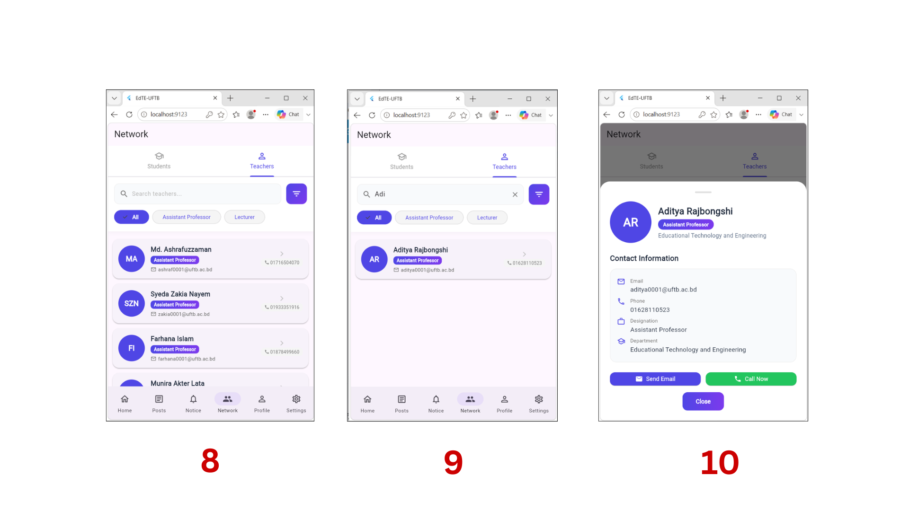
</div>

### 1️⃣1️⃣ – 1️⃣2️⃣ &nbsp; Profile → Settings

<div align="center">
  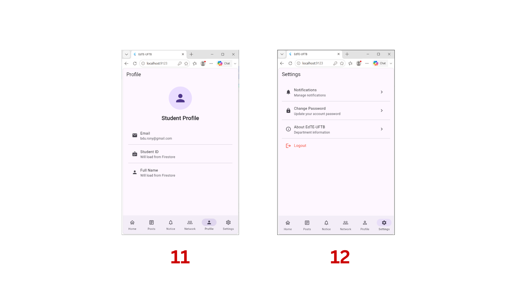
</div>

---

## 🛠️ Tech Stack

| Layer | Technology |
|---|---|
| **Framework** | Flutter (Material 3) |
| **Language** | Dart |
| **Authentication** | Firebase Authentication |
| **Database** | Cloud Firestore |
| **Tooling** | Firebase CLI, FlutterFire CLI |
| **IDE** | VS Code / Android Studio |

---

## 📁 Project Structure

```text
edte_uftb/
├── android/
├── ios/
├── image_readme/            # Screenshots used in this README
└── lib/
    ├── main.dart
    ├── firebase_options.dart
    ├── models/
    │   └── user_model.dart
    ├── services/
    │   └── auth_service.dart
    └── screens/
        ├── auth/
        │   ├── login_screen.dart
        │   └── register_screen.dart
        ├── dashboard/
        │   └── dashboard_screen.dart
        ├── posts/
        │   └── posts_screen.dart
        └── RecordBook/
            ├── StudentListTab.dart
            └── TeacherListTab.dart
```

---

## ⚡ Getting Started

### Prerequisites

- [Flutter SDK](https://docs.flutter.dev/get-started/install) (3.x or later)
- [Firebase CLI](https://firebase.google.com/docs/cli)
- A Firebase project (this app uses `edte-uftb`)

### Installation

```bash
# 1. Clone the repository
git clone https://github.com/<your-username>/edte_uftb.git
cd edte_uftb

# 2. Install dependencies
flutter pub get

# 3. Login and configure Firebase
firebase login
dart pub global activate flutterfire_cli
flutterfire configure

# 4. Run the app
flutter run
```

> 🌐 To run on web: `flutter run -d chrome`

---

## 🗺️ Roadmap

- [x] Sign In / Sign Up with validation
- [x] Firebase integration
- [x] Bottom navigation (Home, Profile, People, Posts, Settings)
- [x] Alumni and teacher directory with search and filter
- [x] Posts CRUD
- [ ] Edit profile
- [ ] Change password
- [ ] Club list
- [ ] Department notices
- [ ] Likes, comments and share on posts
- [ ] Dark mode
- [ ] Delete account

---

## 📬 Contact

<div align="center">

**Md. Rony Ahmmed Shah**
🆔 2002035 · Department of Educational Technology & Engineering, UFTB

[](mailto:bdu.rony@gmail.com)
[](https://linkedin.com/in/rony7s)
[](https://github.com/rony7s)

⭐ If you like this project, give it a star!

</div>
